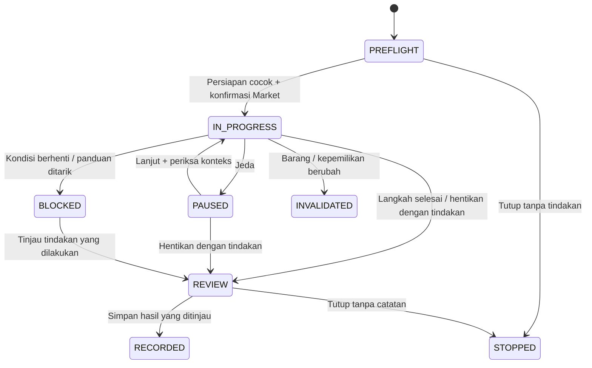

# 33 — Panduan perawatan & perbaikan dengan AI

Implementasi 16 Oktober 2026. Kontrak OpenAPI **1.18.0**, PRD **1.28**.

## Alur pengguna

1. Buka **Barang saya → barang → Lihat panduan**, atau **Panduan saya** untuk melanjutkan sesi.
2. Pilih panduan sesuai kategori, baca cakupan dan alat, lalu simpan sesi. Assessment tidak wajib.
3. Jawab pemeriksaan persiapan. “Belum yakin” tidak dianggap memenuhi syarat. Jawaban yang tidak sesuai menahan tombol mulai.
4. Klik **Mulai mengerjakan**. Dialog memperlihatkan Listing aktif/menunggu review dan jumlah penawaran yang akan berakhir. Konfirmasi memerlukan checklist.
5. Kerjakan satu langkah aktif, lihat diagram yang dapat diperbesar, dan tandai sendiri tindakan yang sudah dilakukan. Peta langkah dapat dibaca tanpa mengubah progres.
6. Jeda dan lanjutkan dari akun yang sama. Pertanyaan dan foto opsional tersimpan privat. AI tidak menandai langkah selesai.
7. Setelah selesai atau berhenti di tengah, tinjau tindakan, hasil, tanggal, kondisi sesudah, biaya dan pilihan berbagi. Simpan draf, catat satu hasil, atau tutup tanpa catatan.



Sesi berjalan yang dihentikan sebelum ada tindakan dapat langsung ditutup. Menghapus tanda selesai mempertahankan riwayat tindakan yang sudah dilaporkan. Satu barang hanya mempunyai satu sesi yang belum ditutup, termasuk ketika dijeda, diblokir, atau sedang ditinjau.

## Katalog versi pertama

| Panduan | Kategori | Jenis aktivitas |
| --- | --- | --- |
| Pasang kembali kancing dua lubang | fashion | REPAIR |
| Kencangkan pegangan laci bersekrup | furniture | REPAIR |
| Bersihkan luar keyboard & mouse | electronics | MAINTENANCE |
| Rawat permukaan luar laptop | electronics | MAINTENANCE |
| Rawat dan simpan buku kering | books | MAINTENANCE |
| Rawat bodi gitar akustik | hobby / musical-instruments | MAINTENANCE |

Kesesuaian kategori merupakan penyaringan awal; pemilik tetap harus mengonfirmasi objek, material, petunjuk produsen, alat dan kondisi. Kerusakan di luar cakupan tidak mempunyai prosedur lanjutan yang dihasilkan AI. Katalog berada di `apps/api/src/modules/tutorials/catalog.ts`; tidak ada editor admin baru.

Setiap sesi menyimpan snapshot panduan, versi dan hash. Perubahan katalog berikutnya tidak mengganti isi sesi yang sudah dibuat. Penarikan versi melalui `REPAIR_TUTORIAL_WITHDRAWN_VERSIONS` menahan kelanjutan tindakan; hasil yang sudah dilakukan tetap dapat ditinjau. Dua diagram geometris asli per panduan berada di `apps/web/public/guides/v1/`, dengan teks alternatif, keterangan dan pembesaran. Aset versi lama harus dipertahankan selama masih dirujuk sesi.

Sumber yang ditinjau:

- [iFixit — How to Replace a Button on a Shirt](https://www.ifixit.com/Guide/How+to+Replace+a+Button+on+a+Shirt/149345).
- [IKEA — Care advice and retightening fasteners](https://www.ikea.com.hk/dairyfarm/hk/pdfs/advice/en/340/AA-2179340-4_pub.pdf).
- [Apple — How to clean your Apple products](https://support.apple.com/en-mide/103258).
- [Library of Congress — Preserving your books](https://guides.loc.gov/preserving-your-books).
- [Canadian Conservation Institute — Basic care of books](https://www.canada.ca/en/conservation-institute/services/conservation-preservation-publications/canadian-conservation-institute-notes/basic-care-books.html).
- [Yamaha — Basic care and maintenance](https://www.yamaha.com/en/musical_instrument_guide/acoustic_guitar/maintenance/).
- [Yamaha — Care and maintenance of an acoustic guitar](https://www.yamaha.com/en/musical_instrument_guide/acoustic_guitar/maintenance/maintenance002.html).

Prosedur ditulis ringkas dalam bahasa Indonesia untuk cakupan yang dibatasi. Tidak ada foto, gambar sumber, atau ilustrasi hasil perbaikan yang disalin.

## Perubahan Market dan kepemilikan

Membaca, membuat sesi dan menyiapkan alat tidak mengubah kondisi, Assessment, Score, Passport atau Impact. Pada START, server menghitung ulang hash pratinjau di transaksi yang sama dengan perubahan status. Perubahan versi barang, sesi, Listing atau penawaran meminta konfirmasi baru.

START menjeda Listing ACTIVE/PENDING_REVIEW dan mengakhiri penawaran berjalan yang memakai barang tersebut, termasuk anggota paket Exchange pada revisi aktif. Guard bersama menahan submit/approve Listing dan penerimaan transaksi serta kelayakan paket Exchange selama `startedAt != null && closedAt == null`. Draft Listing tetap dapat disiapkan. Reservasi yang lebih dahulu berhasil menahan START; START yang lebih dahulu berhasil menahan penerimaan.

Perubahan material, foto barang, perpindahan kepemilikan dan koreksi kepemilikan membatalkan konteks sesi lama. Riwayat tetap hanya milik pembuat sesi dan tidak mengambil detail barang baru milik orang lain. Penutupan sesi tidak mengaktifkan ulang Listing. Penilaian/review baru mengikuti aturan yang sudah berlaku.

## AI dan kegagalan

`TutorialAiService` menggunakan gateway 9router `/chat/completions`, `stream:false`, timeout provider maksimal 60 detik dan batas respons 128 KiB. JSON Schema disertakan di instruksi dan respons divalidasi memakai Zod strict. Parameter `response_format` sengaja mengikuti pola integrasi Valora yang sudah ada: tidak dikirim karena sebagian model yang dirutekan gateway menolaknya. Tidak ada retry provider otomatis.

Model hanya memilih intent, ID blok katalog, label observasi terbatas dan pertanyaan klarifikasi yang tersedia. Teks prosedur, alternatif alat, penjelasan dan FAQ yang ditampilkan berasal dari katalog server. Observasi foto dipetakan ke kalimat ketidakpastian yang telah ditulis; tidak ada diagnosis atau prosedur bebas dari model. Input pengguna dan isi foto diperlakukan sebagai data tidak tepercaya.

Konteks berisi cakupan/langkah/alat terkait, keluhan awal, jawaban persiapan, maksimal enam interaksi relevan pada langkah yang sama, pertanyaan dan foto yang dipilih secara eksplisit. Judul/deskripsi barang, identitas akun, alamat, harga, chat Market dan data transaksi tidak otomatis dikirim. Pengguna tetap dapat memasukkan data pribadi ke teks bebas; UI meminta menghindarinya.

Kuota memakai bucket harian WIB yang sama dengan Explainer dan analisis foto: default 20 percobaan per pengguna, 200 per aplikasi, dua lease provider global, lease 90 detik dan 10 pertanyaan per menit. Ketiga tabel lease dihitung dalam transaksi `serial`. Dedup UUID permintaan diperiksa sebelum reservasi kuota; replay tidak memanggil provider. Percobaan ulang yang sengaja dibuat dengan UUID baru menggunakan kuota baru.

Jawaban terlambat diperiksa ulang terhadap pemilik, revisi material, persiapan, foto, reservasi, status penutupan dan penarikan panduan. Jawaban langkah lama tetap diberi konteks langkah asal; STOP yang masih relevan menahan kelanjutan sesi. AI mati, kuota habis, output tidak valid atau provider gagal menghasilkan status UNAVAILABLE yang jujur. Panduan, penjelasan katalog, progres, jeda dan pencatatan tetap tersedia. Status PENDING dapat dipulihkan tanpa mengirim pertanyaan ulang; lease kedaluwarsa menjadi UNAVAILABLE.

## Foto dan privasi

- Maksimal 12 foto sesi, tiga foto per pertanyaan dan empat foto bukti catatan.
- Tiket 15 menit; JPEG/PNG/WebP maksimal 8 MiB/20 megapiksel. Pemrosesan MediaService memutar orientasi, membuang metadata dan menghasilkan WebP maksimal 2000 piksel.
- Foto sesi memakai tabel dan endpoint privat terpisah, bukan MediaAsset galeri atau foto Listing. Tiket diotorisasi ulang saat upload dan finalisasi.
- Tautan akses bertanda tangan mengikat pembuat, sesi, foto dan waktu lima menit. Pembacaan mengotorisasi ulang dan memakai `private, no-store`.
- Untuk AI: hasil proses maksimal 1280 piksel, total tiga MiB, dikirim sebagai data URL; tidak mengambil URL gambar asing.
- Bukti yang dipilih disalin ke storage key baru dan tiket REPAIR_EVIDENCE. Pencatatan mengonsumsi salinan secara atomik; salinan yang tidak terpakai masuk antrean penghapusan. Penghapusan foto sesi tidak menghapus bukti catatan.
- Berbagi ringkasan publik dan rincian/foto dengan pemilik berikutnya default **false**. Sesi dan percakapannya tidak ikut berpindah. Tidak ada antarmuka admin untuk menjelajahi sesi privat.

## Catatan, Passport dan Impact

`RepairsService.createInTransaction` dipakai bersama oleh catatan manual dan sesi. Satu transaksi menyimpan catatan, kondisi/revisi barang, foto bukti, Passport, Impact yang sesuai, dan penutupan sesi. Unique `tutorialSessionId` menjaga satu catatan per sesi, termasuk bila kunci aksi browser hilang.

Jenis aktivitas berasal dari katalog pada sesi, dipilih pengguna pada formulir manual, dan tidak dapat dikoreksi dengan mengganti jenis. Default data lama adalah REPAIR. Koreksi jenis dilakukan dengan void dan catatan baru.

- REPAIR menghasilkan REPAIR_RECORDED dan kontribusi REPAIRS_RECORDED.
- MAINTENANCE menghasilkan MAINTENANCE_RECORDED dengan aturan privasi yang sama dan tidak menambah REPAIRS_RECORDED.
- Void/restore dan koreksi admin mempertahankan perbedaan ini.
- Hasil SUCCEEDED/UNSUCCESSFUL tetap laporan pemilik. REPAIR yang belum berhasil tetap satu aktivitas yang dilaporkan, bukan klaim keberhasilan.
- Tidak ada kenaikan Score, verifikasi fisik, metrik perawatan baru atau perpindahan kepemilikan otomatis.

Tutup tanpa catatan tetap memerlukan tinjauan kondisi sesudah. Kondisi yang disetujui diperbarui melalui aturan revisi barang, tanpa event catatan Passport atau kontribusi Impact.

## API dan pemulihan

Endpoint katalog ada di `/repair-guides`, kecocokan barang di `/items/:itemId/repair-tutorials`, pembuatan sesi di `/items/:itemId/repair-tutorial-sessions`. Daftar/detail, start-preview, actions, questions, pemulihan questions/by-request, photos/tickets, photos/finalize dan record berada di `/repair-tutorial-sessions`. Akses/baca/hapus foto di `/repair-tutorial-photos`.

Semua memerlukan sesi aktif; mutasi memerlukan CSRF. Pembuatan, actions dan record memerlukan Idempotency-Key UUID. Operation `tutorial-create`, `tutorial-action`, `tutorial-record` terdaftar pada pemulihan aksi dan memeriksa pembuat sesi. Snapshot respons idempoten hanya ID, versi dan ID catatan; isi privat tidak disalin ke cache pemulihan. Aktor lain mendapat 404, konteks/versi berubah atau penggunaan ulang identitas dengan payload berbeda mendapat 409. DTO menyediakan capabilities dari server; client tidak memutuskan izin sendiri.

## Retensi dan konfigurasi

Sesi belum ditutup dipertahankan untuk dilanjutkan. Setelah ditutup 90 hari, keluhan, jawaban persiapan, draf, pertanyaan, jawaban AI dan foto sesi dihapus; metadata panduan/progres/status/link catatan dipertahankan. Foto bukti yang sudah disalin mengikuti retensi catatan biasa. Akun ditutup mengikuti anonimisasi 30 hari dan pemeriksaan hold yang sudah ada. Kasus/koreksi/laporan terkait barang serta hold menahan penghapusan. Pemeriksaan akun diterapkan secara konservatif sehingga kasus lain yang masih aktif juga dapat memperpanjang retensi sesi.

Job maintenance membersihkan lease dan PENDING kedaluwarsa, tiket yatim melalui MediaService, serta antrean penghapusan storage. Jangan mencatat teks pertanyaan, foto, prompt, token atau API key ke log. Metadata kegagalan terbatas pada status/kode terkontrol.

```dotenv
REPAIR_TUTORIALS_ENABLED=false
AI_REPAIR_TUTORIAL_ENABLED=false
AI_REPAIR_TUTORIAL_MODEL=
REPAIR_TUTORIAL_WITHDRAWN_VERSIONS=
```

Model kosong memakai AI_PHOTO_MODEL, lalu AI_MODEL. `REPAIR_TUTORIALS_ENABLED` mengatur pembuatan sesi baru; sesi lama tetap dapat dibaca, ditutup dan dicatat. Mematikan flag tidak menghapus guard Market sesi berjalan. Contoh penarikan: `sew-button@1,drawer-handle@1`. Kunci tetap hanya pada `.env.local`.

Migrasi aditif `20261016010000_repair_tutorials` menambahkan tabel sesi/interaksi/foto/lease, enum tujuan upload dan jenis aktivitas, FK tiket, link catatan unik, serta unique partial index satu sesi belum ditutup per barang. Diterapkan ke `valora_dev` melalui deploy tanpa reset/seed. Database lain perlu `pnpm db:deploy` sebelum API baru dijalankan.

## Bukti implementasi dan batas pemeriksaan

Build contracts/API/web, typecheck dan lint digunakan untuk pemeriksaan kompilasi. Tidak menambah atau menjalankan suite tes otomatis pada sesi ini. Peninjauan UI menggunakan data demo berlabel simulasi, tanpa Listing publik, uang atau klaim tindakan fisik nyata. Bukti desktop 1440 px, ponsel 390 px dan 320 px serta review Impeccable tercatat pada `apps/web/.impeccable/review/repair-tutorials/`.

Kasus concurrency banyak worker, replay lintas perangkat, semua kombinasi transaksi enam barang, retensi berumur 90 hari, dan penarikan versi pada deployment lain memerlukan pengujian otomatis/integrasi tersendiri sebelum rollout produksi luas. Implementasi guard dan transaksi tidak merupakan bukti bahwa semua kombinasi tersebut sudah diuji.


### Hasil peninjauan lokal

Build produksi menyediakan halaman katalog, panduan aktif dan daftar sesi. Peninjauan browser mencakup persiapan, konfirmasi mulai, langkah berurutan, jeda, pertanyaan unavailable, upload foto privat, tinjauan hasil sebagian, simpan draf/pilihan bukti lalu reload, konfirmasi pencatatan, dan sesi tercatat. Catatan demo yang dibuat berjenis MAINTENANCE dengan satu foto bukti dan kedua pilihan berbagi false. Dua barang baru berlabel Demo panduan memakai diagram asli sebagai data simulasi; metadata rute tersimpan pada `.local/tutorial-demo.json` yang diabaikan Git.

Gateway lokal di port 20128 tidak aktif selama peninjauan. Respons AI langsung yang berhasil belum diverifikasi; tiga pertanyaan demo menunjukkan fallback unavailable. Tidak ada klaim bahwa konten model langsung, semua ACL negatif, seluruh race atau job retensi berumur panjang sudah diuji.
